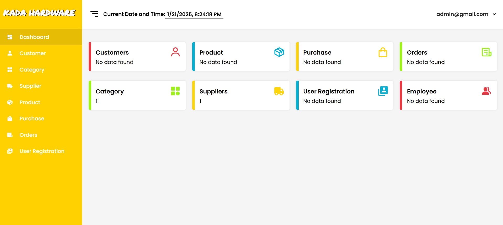

# Kada Hardware Simple Inventory System
- [Introduction](#introduction)
- [Features](#features)
- [Usage](#usage)

## Introduction
This application makes it easy to manage your hardware inventory. It uses basic web technologies like HTML, CSS, JavaScript, PHP, and MySQL to create a simple yet effective inventory system.



## Features
1. `User-Friendly Interface:` The system's interface is clean and intuitive, allowing users to navigate easily and perform tasks.
2. `Real-Time Inventory Updates:` Maintain up-to-date inventory records with real-time tracking of stock levels, ensuring that you never run out of essential items.
3. `User Registration:` Admin can approve and reject user registration requests.
4. `Customer Management:` Easily manage customer information.
5. `Category Management:` Organize products into categories for better inventory management.
6. `Supplier Management:` Easily manage supplier information.
7. `Product Management:` Manage product details, including prices and quantity.
8. `Purchase Management:` Record and track purchases.
9. `Order Management:` Record of customer orders.
10. `Secure Access:` Utilize secure login and user management features to ensure that only authorized personnel can access the system.

## Usage
To get started with the project, follow these steps:

1. Clone the repository:
   ```bash
   git clone https://github.com/JerwinCauilan/kada-simple-inventory-system.git
2. Navigate to the project directory:
   ```bash
   cd kada-simple-inventory-system
3. Setup the database:
   * Create a MySQL database called `"kada"`.
   * Navigate to the `assets` folder and click the `db` folder.
   * Import the provided SQL file `(kada.sql)` into your database.
4. Configure the application:
   * Update the `config.php` file with your database credentials and other configurations.
5. Access the application:
   * Open your web browser and navigate to
     ```bash
     http://localhost/kada-simple-inventory-system
6. Login and access the admin:
   * Use the default admin credentials.
   * Username:
     ```bash
     admin
    * Password:
      ```bash
      123
